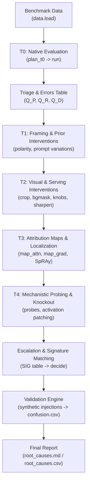

# Qwen3-VL Error Analysis Engine

Root-cause analysis and diagnostic attribution engine for Vision-Language Models (specifically **Qwen3-VL-4B-Instruct**) evaluating safety-violation detection, industrial hazards, and streaming event monitoring.

Every evaluation unit converts model decisions into a margin $s = \text{logsumexp}(\text{logit}[\text{pos}]) - \text{logsumexp}(\text{logit}[\text{neg}])$, where $s > 0$ strictly denotes positive model assertion.

---

## 1. Pipeline Architecture & Workflow

The diagnostic framework escalates unexplained errors through hierarchical intervention and attribution tiers:



### CLI Subcommands
| Command | Role | Primary Output |
|---|---|---|
| `ea selfcheck` | Pre-flight environment & model assertions | Verification log |
| `ea t0` | Base zero-shot evaluation on positive/negative prompts | `runs.jsonl` (base rows) |
| `ea t1` | Cheap framing, paraphrasing, and prior interventions | `runs.jsonl` (POL/FRM arms) |
| `ea t2` | Counterfactual cropping, masking, and knob sweeps | `runs.jsonl` (O1–O7 arms) |
| `ea hazard` | Latent hazard prediction and secured twin controls | `runs.jsonl` (HZ.* arms) |
| `ea stream` | Online streaming causal video anticipation ($k$-of-$n$) | `stream_summary.csv` |
| `ea t3` | Eager attention/gradient saliency, explainer gate, SpRAy | `outputs/t3/t3_loc.json` |
| `ea t4` | Feature caching, linear probing, knockout causal checks | `outputs/t4/t4_verdicts.json` |
| `ea validate` | Injects synthetic known causes to measure false attributions | `outputs/validate/confusion.csv` |
| `ea report` | Merges all tiers, enforces accounting identity, writes report | `root_causes.md`, `root_causes.csv` |

---

## 2. Quickstart Guide

### Option A: Running with Docker (Recommended)
The codebase includes full Docker and `docker-compose` containerization:

```bash
# 1. Set environment variables
cp .env.example .env

# 2. Run test suites offline (no model download required)
docker compose run test

# 3. Run full toy pipeline end-to-end
docker compose run t0 --data toy
docker compose run t1 --data toy
docker compose run t2 --data toy
docker compose run hazard --data toy
docker compose run validate --data toy
docker compose run report --data toy
```

### Option B: Running with Real Benchmarks
The engine automatically handles dataset discovery, conversion, and caching under `data/<bench>/`:

```bash
# Gated dataset via Git clone (e.g. ConstructionSite10k):
git clone https://huggingface.co/datasets/LouisChen15/ConstructionSite ./data/cs10k_raw

# Run evaluation (auto-detects local clone, converts, and evaluates):
docker compose run t0 --data cs10k
```

Supported benchmarks in `_BENCH_REGISTRY`:
- `toy`: Synthetic diagnostic dataset generator (`make_toy`)
- `cs10k`: ConstructionSite10k image safety benchmark (`LouisChen15/ConstructionSite`)
- `isafetybench`: Industrial action safety video benchmark (`raiyaanabdullah/isafety-bench`)
- `fieldworkarena`: Fujitsu multi-modal enterprise safety benchmark (`Fujitsu/FieldWorkArena_Dataset`)
- `pasbench`: PaSBench video proactive streaming safety benchmark (`beingbetter11643/PaSBench-Video`)
- `ovo_bench_rt`: OVO-Bench Real-Time Visual Perception subset (`JoeLeelyf/OVO-Bench`)

---

## 3. Key Invariants & Safeguards

1. **Accounting Identity (FR-E-11):** Every error partitions into exactly one terminal state; counts strictly sum to 100% of the error corpus.
2. **Empirical Validation (FR-V-1..3):** A cause is labeled `decisive` only when empirical precision under synthetic injections $\ge 0.8$; otherwise it remains `candidate`.
3. **Paired Controls:** Every recovery arm requires a named matched control; `N0.null` serves as the noise-floor control.
4. **Deterministic Reproducibility (NFR-1):** All sampling, shuffling, ROAD imputation (`nli`), and cluster bootstrapping are deterministically seeded.
